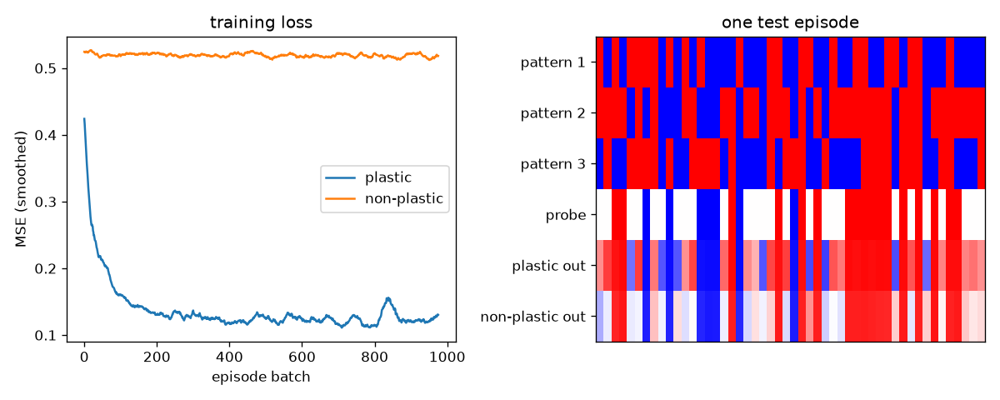

# Differentiable plasticity

A small reimplementation of the pattern-completion experiment from Miconi et al., "Differentiable plasticity: training plastic neural networks with backpropagation" ([arXiv 1804.02464](https://arxiv.org/abs/1804.02464)).

Each connection in the recurrent net has a fixed weight `w` and a Hebbian trace `Hebb` that starts at zero in every episode, with a learned per-connection coefficient `alpha`:

```
x(t)        = tanh(x(t-1) @ (w + alpha * Hebb) + input(t))
Hebb_ij(t+1) = (1 - eta) * Hebb_ij(t) + eta * x_i(t-1) * x_j(t)
```

`w`, `alpha` and `eta` are trained with BPTT. In each episode the net sees 3 random ±1 patterns of 50 bits, twice over in shuffled order (6 steps per pattern, 4 blank steps in between). It then gets one of them with half the bits zeroed and has to output the full pattern. The patterns are new every episode, so they can only be stored through plasticity. The baseline is the same 50-neuron RNN without the plastic term.

## Setup

```
pip install -r requirements.txt
```

## Run

```
python plasticity.py           # 1000 batches of 32 episodes per model, ~2-3 min on CPU
python plasticity.py --quick   # 200 batches
```

Prints test MSE and the bit error on the missing half for both nets, and writes `demo.png`.

## Test

```
python -m pytest -q
```

## Results



Results on 1000 fresh test episodes after 1000 training batches: the plastic net gets 3.8% of the missing bits wrong (MSE 0.111). The non-plastic RNN gets 50.1% wrong (MSE 0.515), so on those bits it does no better than a coin flip. All it learns is to copy the half of the probe that is visible. The learned eta settles at about 0.008.
